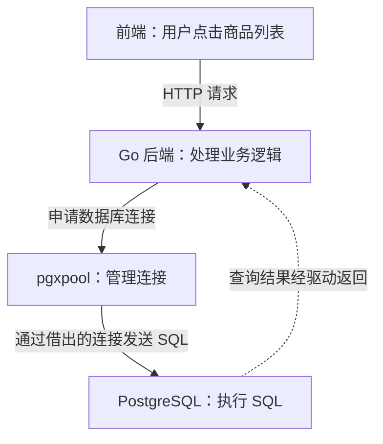

# 样本 01｜概念与工程组件

用户问题：什么是 pgxpool？

适用：首次了解一个技术组件，希望理解其作用、原理与使用边界。

以下是回答范例，非固定模板。

---

# 什么是 pgxpool？

`pgxpool` 是 Go 的 PostgreSQL 驱动库 `pgx` 提供的连接池组件。它的核心作用是**让多个后端请求重复使用数据库连接，并控制同时使用的连接数量**。

## 1. What：它在后端中的位置

假设你正在开发一个电商网站，用户点击商品列表，Go 后端就需要向 PostgreSQL 查询商品数据。



**数据库连接（Database Connection）** 是后端与数据库之间建立的一条通信通道。有了它，后端才能发送 SQL 并接收查询结果。

**数据库驱动（Database Driver）** 是帮助编程语言与数据库通信的代码库。pgx 是 Go 中的一种 PostgreSQL 驱动，pgxpool 是它提供的连接池实现。

## 2. Why：为什么需要连接池？

假设没有连接池，每个请求都自行创建并关闭连接：

```text
建立网络连接 → 身份认证 → 执行 SQL → 接收结果 → 关闭连接
```

用户实际需要的只是执行 SQL 并获取结果，但程序还要重复建立连接、进行身份认证和关闭连接。

假设单次查询的耗时如下（仅用于说明原理，不是实际性能测试）：

| 环节 | 假设耗时 |
|---|---:|
| 建立连接及认证 | 5 ms |
| 执行查询并接收结果 | 9 ms |
| 关闭连接 | 1 ms |

如果每秒有大量请求访问数据库，这些重复操作就会增加网络、CPU 和数据库资源开销。

那么，查询结束后能否先不关闭连接，而是交给下一个请求复用？这就是连接池的设计思路。

## 3. How：连接池如何分配连接？

假设连接池已经建立 3 条连接，且最大连接数为 3。4 个请求先后到达：

| 时刻 | 连接 1 | 连接 2 | 连接 3 | 等待请求 |
|---|---|---|---|---|
| 初始 | 空闲 | 空闲 | 空闲 | 无 |
| A、B 到达 | A | B | 空闲 | 无 |
| C、D 到达 | A | B | C | D |
| A 完成 | D | B | C | 无 |
| 全部完成 | 空闲 | 空闲 | 空闲 | 无 |

A 完成后归还连接 1，D 就能直接借用这条已建立的连接，无须重新进行网络连接和身份认证。若一直没有可用连接，D 可能因等待超时或取消而失败。

这就是 Connection Pool（连接池）：管理一组可重复使用的连接，根据请求情况分配和回收。通常一条被借出的连接由当前操作占用，不是供多个请求任意同时使用的。

### 代码层面有什么区别？

以下为机制示意，省略导入、错误处理等生产代码细节。

不使用连接池：

```go
func queryProduct() {
    conn, _ := pgx.Connect(ctx, dbURL)
    defer conn.Close(ctx)
    conn.QueryRow(ctx, sql).Scan(&product)
}
```

每次调用都建立一条连接，函数结束时关闭。

使用连接池：

```go
// 服务启动时创建一次，共享给业务代码；服务关闭时关闭池
pool, _ := pgxpool.New(ctx, dbURL)

func queryProduct() {
    pool.QueryRow(ctx, sql).Scan(&product)
}
```

`QueryRow` 获取连接，`Scan` 读取结果并归还连接。连接池本身按需创建和维护连接，业务代码无需每次手动建立和关闭连接。

## 4. When：什么时候应该使用？

| 场景 | 判断 |
|---|---|
| 长时间运行的 Web 后端、并发数据库请求 | 适合使用连接池 |
| 只执行一次查询就退出的小脚本 | 通常不必使用池 |
| 需要长期独占连接的操作 | 根据需求借出专用连接或独立建立连接 |

也不是连接越多越好。每条连接会占用资源，大量连接同时执行 SQL 可能导致数据库资源竞争。

## 5. Compare：与其他数据库访问方式有什么区别？

| 工具 | 职责 |
|---|---|
| `pgx.Conn` | 单条 PostgreSQL 连接 |
| `pgxpool` | pgx 的原生连接池，管理多条可复用连接 |
| `database/sql` | Go 标准库数据库访问接口，自带连接池管理，需配合兼容驱动 |

**pgxpool 的本质是在 Go 后端和 PostgreSQL 之间提供数据库连接的资源管理能力。** 它不负责优化 SQL 本身，而是管理 SQL 通过什么连接发送给数据库。
