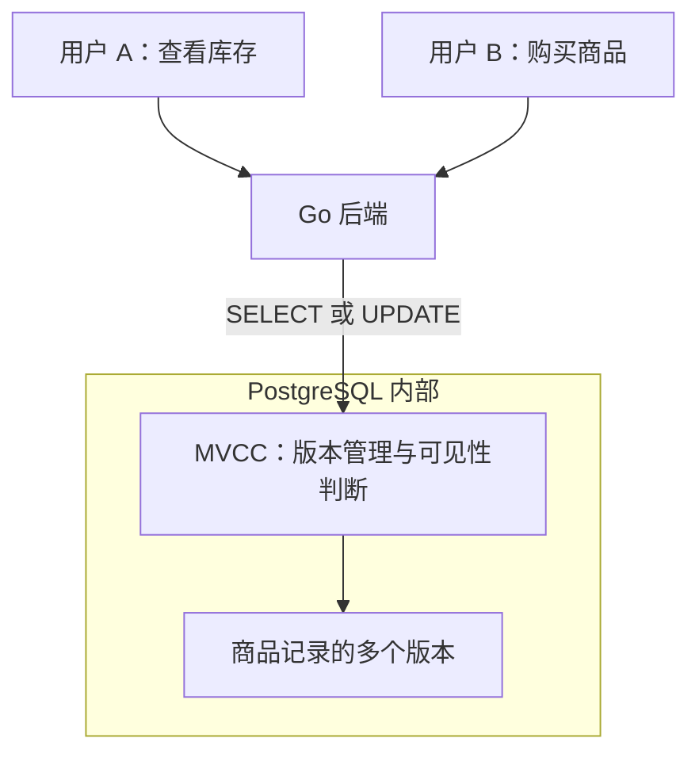

# 样本 02｜陌生技术与知识铺垫

用户问题：什么是数据库的 MVCC？

适用：用户知道基本 SQL，但尚不熟悉事务、快照、隔离等前置知识。以下为回答范例。

---

# 什么是数据库的 MVCC？

MVCC（Multi-Version Concurrency Control，多版本并发控制）是一种处理数据库并发读写的机制。它的核心思想是：**修改数据时暂时保留新旧版本，让不同的查询读取自己应该看到的版本。**

因此，即使有人正在修改一条数据，其他人通常也可以继续普通读取，而无须等待修改完成。

## 1. What：它在系统中的位置



与 pgxpool 不同，MVCC 不是 Go 后端需要主动调用的库，而是 PostgreSQL 自身管理并发访问的内部机制。执行普通 SQL 时就会用到它。

## 2. Why：为什么需要 MVCC？

假设电商数据库里手机库存为 100。用户 A 正在查询库存，用户 B 购买了一部手机，数据库需要将库存修改为 99。

如果两件事在不同时间发生，处理起来并不困难。但如果恰好同时发生呢？

一种简单的方案是让 B 修改期间独占这条数据，A 等待修改完成后再读取。这样不会读到尚未完成的修改，但会产生等待。

```text
B 开始修改 ────────── B 完成修改
A 请求读取 ── 等待 ── A 读取 99
```

如果修改耗时较长，其他普通查询就可能受影响。（这是简化的互斥锁方案，并不是 PostgreSQL 普通读取的行为。）

既然 A 只是想查看已经存在的数据，为什么不能暂时保留库存 100，同时创建一个新版本 99，让两个人访问不同版本呢？这就是 MVCC 的设计思路。

## 3. How：数据库内部发生了什么？

先补充一个必要概念：**事务（Transaction）** 是一组作为整体完成的数据库操作。例如购买商品可能涉及修改库存和创建订单。操作全部成功时，通过 `COMMIT`（提交）确认修改；失败时可用 `ROLLBACK`（回滚）撤销尚未提交的修改。

继续沿用库存案例：

| 阶段 | 数据库中存在的版本 | A 此时新发起的普通查询 | B 在自己的事务中 |
|---|---|---:|---:|
| 初始 | V1：100，已提交 | 100 | 100 |
| B 修改但未提交 | V1：100；V2：99，未提交 | 100 | 99 |
| B 提交 | V1：100；V2：99，已提交 | 99 | 99（提交结果） |

```text
B 修改但尚未提交时：

A 的普通 SELECT ──→ V1：库存 100（已提交）
B 自己的事务   ──→ V2：库存  99（尚未提交）
```

A 和 B 访问的是同一条逻辑记录的不同版本。因此普通读取通常不必因为有人正在修改这条记录而等待。

### 3.1 如何知道该读哪个版本？

保留多个版本只是第一步。假设 B 最终购买失败，撤销了库存修改。如果 A 提前读到 99，就读到了一个实际上没有生效的修改。

所以数据库不能简单地把最新版本当成正确版本，而要根据查询可见的数据范围来选择版本。这就引出了 **Snapshot（快照）**。

快照不是将整个数据库复制一份，而是用于配合事务状态与数据版本信息，判断哪些版本对当前查询可见的依据。

```text
A 发起 SELECT
      │
      ▼
按快照和版本信息判断可见性
      ├─ V1：100，已提交且可见 → 读取
      └─ V2： 99，其他事务未提交 → 不读取
```

至此可以把 MVCC 分为两部分：多版本存储（让新旧数据同时存在），以及版本可见性（决定应该读哪个版本）。两者缺一不可。

### 3.2 用两个 SQL 窗口复现

在测试数据库中准备一条 `products` 记录，假设 `id=1`，库存为 100。使用 PostgreSQL 默认隔离级别 Read Committed（读已提交），这里可以先理解为每条普通查询按开始时的快照读取数据。

窗口 B 先执行（不要立即提交）：

```sql
BEGIN;
UPDATE products SET stock = 99 WHERE id = 1;
```

两个窗口各执行：

```sql
SELECT stock FROM products WHERE id = 1;
```

此时 A 读到 100，B 读到 99。随后在 B 执行 `COMMIT;`，A 再发起一次查询，应读到 99。以上为满足假设条件时的预期结果，并非已运行的实验。

## 4. When：它在哪些场景发挥价值？

电商网站中大量商品浏览和库存更新同时发生；企业管理系统中员工同时编辑记录、管理者查看数据；大型报表查询进行时后台仍在更新数据。这些都是读写并发的场景。

MVCC 并不是 PostgreSQL 中需要业务开发者手动开启的功能。开发者真正需要关注的是事务设计和数据一致性要求。

## 5. Compare：MVCC 能替代锁吗？

| 对比 | 简单读写互斥方案 | MVCC |
|---|---|---|
| 核心思想 | 限制同时访问 | 保留不同版本 |
| 普通读写 | 可能相互等待 | 通常可并行 |
| 代价 | 等待与资源竞争 | 额外版本存储、可见性判断及回收 |

但如果只剩一部手机，两个人同时购买，就必须协调竞争性修改。MVCC 本身并不保证不会超卖，数据库仍需要锁等机制，业务也需要正确判断库存。

**MVCC 与锁可以互相配合，而不是简单替代。** 它的本质是通过额外的版本管理成本减少普通读写之间的等待，同时遵守数据可见性规则。
