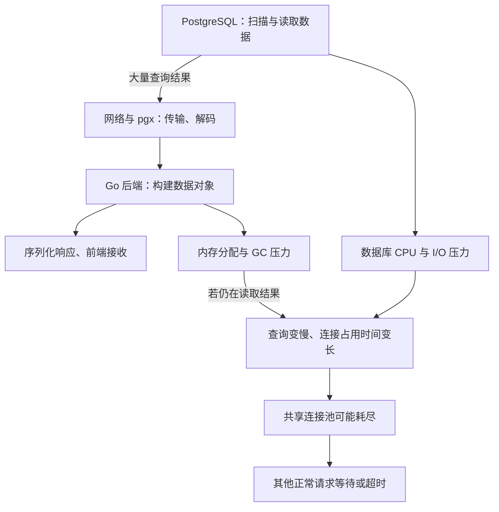

# 样本 03｜因果与工程故障

用户问题：为什么 PostgreSQL 中的 SELECT * 可能导致后端服务卡死？

适用：解释故障机理，而不是在没有日志时断言真实故障原因。以下为回答范例。

---

# 为什么 SELECT * 可能导致后端服务卡死？

`SELECT *` 表示查询所有字段。如果又没有限制查询范围，就可能一次性返回整张表的数据。它本身不是错误 SQL，真正的问题是大量数据可能消耗数据库、网络、后端内存和连接池资源，导致其他请求也受到影响。

## 1. What：这条 SQL 实际做了什么？

假设文章后台的列表只展示文章 ID 和标题，数据库中的每篇文章还包含正文、作者编号和特征向量等字段。

| 字段 | 假设大小 |
|---|---:|
| id | 8 B |
| title | 200 B |
| author_id | 8 B |
| content | 100 KB |
| embedding | 6 KB |
| created_at | 8 B |

如果后端使用 `SELECT * FROM articles;`，数据库就会返回所有字段和所有可见记录，而不仅仅是列表需要的两列。

## 2. Why：数据量差别有多大？

假设共有 10,000 篇文章，按上面的字段大小粗略估算（十进制单位，忽略协议、存储和序列化开销）：

| SQL | 返回的数据量 |
|---|---:|
| `SELECT * FROM articles` | 约 1.06 GB |
| `SELECT id, title FROM articles` | 约 2.08 MB |
| `SELECT id, title FROM articles ORDER BY id LIMIT 20` | 约 4.16 KB |

三个查询承担的是相似的页面需求，但第一个传输了大量页面不需要的数据。数据量为什么会拖慢整个系统？接着看完整执行链。

## 3. How：故障是如何传播的？



### 3.1 数据库阶段

没有 `WHERE`、`LIMIT` 等约束时，数据库通常需要访问整张表的大量数据。逐步扫描表的访问方式叫 Sequential Scan（顺序扫描）。索引则类似快速定位记录的目录，在合适的过滤条件下可能避免访问大量无关数据。

但 `SELECT *` 不必然导致顺序扫描，顺序扫描也不是坏事。实际访问方式由数据库执行计划决定。

### 3.2 后端阶段

假设后端把每一行全部读入一个切片：

```go
// 机制示意，省略错误处理；并非生产代码
rows, _ := pool.Query(ctx, "SELECT * FROM articles")
defer rows.Close()
var articles []Article
for rows.Next() {
    var a Article
    rows.Scan(&a.ID, &a.Title, &a.AuthorID,
        &a.Content, &a.Embedding, &a.CreatedAt)
    articles = append(articles, a)
}
```

每读取一行，就构建一个 Article 并存入切片。由于最终保留全部对象，内存占用可能不断增长。多个请求同时执行，会进一步放大内存分配和 GC（垃圾回收，即 Go 回收不再使用的内存）压力。极端情况下，进程可能因内存不足退出。

### 3.3 为什么其他正常 API 也会受影响？

还记得 pgxpool 吗？假设池最多允许 5 条连接，每个大型查询在结果读完或关闭前占用一条连接：

| 状态 | 连接 1 | 连接 2 | 连接 3 | 连接 4 | 连接 5 | 新请求 |
|---|---|---|---|---|---|---|
| 3 个大型查询 | 忙 | 忙 | 忙 | 空闲 | 空闲 | 可获得连接 |
| 5 个大型查询 | 忙 | 忙 | 忙 | 忙 | 忙 | 等待或超时 |

其他 API 的 SQL 可能只需要几毫秒，却连执行 SQL 所需的连接都拿不到。这就是共享资源导致的故障扩散。

这是一条可能的故障传播路径，而非所有 `SELECT *` 都必然引发的问题。

## 4. When：什么时候可以使用 SELECT *？

临时查看少量数据、按主键获取确实需要的完整记录，通常是合理的。列表页面只需要少量列时、高频接口无约束读取大表时，就应谨慎。

判断依据是实际返回的行数、每行大小、请求频率和系统处理能力，而不只是有没有星号。

## 5. Compare：优化手段分别解决什么问题？

| 方法 | 实际作用 |
|---|---|
| 指定列 `SELECT id, title` | 减少每行返回的数据量 |
| `WHERE author_id = 1` | 减少符合条件的记录数 |
| `LIMIT 20` | 限制单次返回行数 |
| 合适的索引 | 减少定位目标数据的成本 |
| 查询超时 | 避免查询无限制占用资源（需要正确配置与传播取消） |
| 流式处理 | 避免所有结果同时堆积在内存 |

这些措施可以组合。注意 LIMIT 只限制返回行数，不保证复杂排序、聚合等操作只处理这么多行。

## 6. 如何验证实际故障？

不能仅凭 SELECT * 就认定真实故障原因。

| 观测现象 | 优先检查 |
|---|---|
| 数据库 CPU、I/O 很高 | 活跃查询、执行计划、扫描量 |
| Go 内存持续增长 | 是否大量累积查询结果、内存分配与 GC |
| 多个 API 同时超时 | 连接池占用、等待时间和获取失败 |
| 数据库 CPU 低但响应慢 | 锁等待、网络、连接池等待 |
| 进程退出或重启 | OOM（内存耗尽）及容器、系统日志 |

`EXPLAIN` 可以查看数据库计划如何执行 SQL；`EXPLAIN (ANALYZE, BUFFERS)` 会实际运行查询并记录耗时等信息。后者应该在安全环境使用，不要在已经出现严重故障的生产库贸然运行高负载查询。

**SQL 优化的本质是让整个系统用合理的资源完成业务需求，而不是机械地禁止 SELECT *。**
