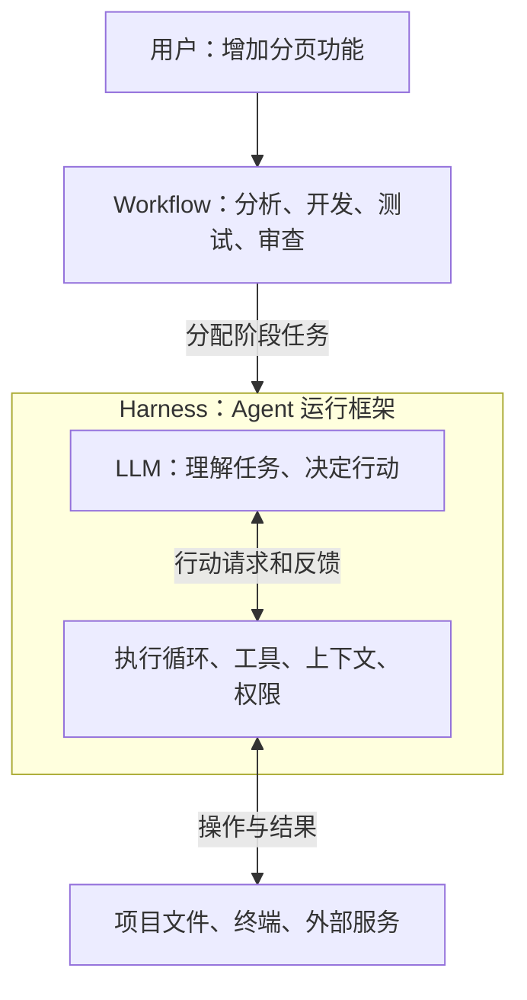
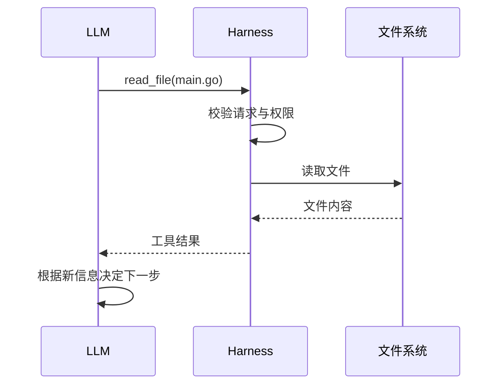
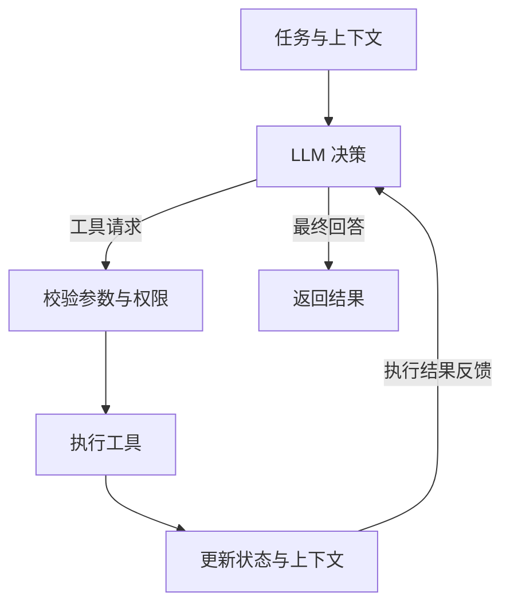

# 样本 04｜架构与技术对比

用户问题：Harness 和普通 Agent Workflow 有什么区别？

适用：对比架构职责和执行逻辑。以下为回答范例；伪代码是教学示例，不是任何产品的真实源码。

---

# Harness 和普通 Agent Workflow 有什么区别？

**Workflow 负责组织任务怎样推进，Harness 则提供并管理 Agent 执行任务的运行环境。** 两者并非互斥：工作流可以调用具有 Harness 的 Agent，Harness 也可以支持工作流。

## 1. What：它们分别承担什么职责？

假设我们正在开发一个 AI 编程助手，任务是为 Go 后端的文章查询接口增加分页功能，并通过测试。



这是一种组合架构示意，并非所有系统必须采用该分层方式。Workflow 关注任务阶段和衔接关系；Harness 关注如何让模型读取文件、执行工具、管理状态并持续获得反馈。

## 2. Why：为什么模型需要运行框架？

直接调用 LLM API 要求读取 `main.go`，模型本身没有直接访问电脑文件系统的能力。若提供了工具定义，模型可以返回类似这样的请求：

```json
{"tool": "read_file", "arguments": {"path": "main.go"}}
```

这只是表达行动意图，文件还没有被读取。外部程序必须解析请求、检查权限、调用读取函数，将文件内容返回给模型。



这一部分运行能力就是 Harness 的职责。只定义“分析 → 开发 → 测试”的业务流程，并不会自动提供这些能力。

## 3. How：让两套代码执行相同任务

统一任务：增加文章分页；可用能力相同（文件搜索、读取、编辑、测试、Skill）；验收标准相同（实现分页且相关测试通过）。以下为简化 Python 伪代码。

### 方案 A：预定义 Agent Workflow

```python
def develop_pagination(task):
    plan = llm(task)
    files = search_files("article")
    code = read_files(files)
    patch = llm(plan, code)
    apply_patch(patch)
    result = run_command("go test ./...")
    for attempt in range(3):
        if result.success:
            break
        patch = llm(result.error, read_files(files))
        apply_patch(patch)
        result = run_command("go test ./...")
    return generate_report(result)
```

模型参与分析、生成代码和修复错误，但是模型何时被调用、什么时候读取文件和测试，主要由开发者写入的程序决定。

### 方案 B：Harness 支撑的自主 Agent

```python
tools = {
    "search_files": search_files,
    "read_file": read_file,
    "apply_patch": apply_patch,
    "run_command": run_command,
    "read_skill": read_skill,
}

def agent_harness(task):
    context = build_context(task)
    for step in range(MAX_STEPS):
        action = llm(context=context, available_tools=tools)
        if action.type == "final_answer":
            return action.content  # 模型声称结束，不代表验收已通过
        check_permission(action)
        result = tools[action.name](**action.arguments)
        context.add(action)
        context.add(result)
        context = manage_context(context)
    return "达到执行次数上限"
```

这里没有针对分页编写具体步骤。同一框架可以执行不同任务，前提是拥有所需能力和权限。生产系统还应处理工具异常、预算、停止条件、验收等；示例只展示核心循环。



反复调用模型、执行工具、获取反馈的机制称为 Agent Loop（智能体执行循环）。

### 面对意外情况时的行为

假设项目中已有公共分页组件，但开发者未在 Workflow 中设计额外搜索它的步骤：

| 当前状态 | 方案 A | 方案 B 的可能行为 |
|---|---|---|
| 定位文章接口 | 按预设节点搜索 | 模型选择搜索工具 |
| 发现分页组件线索 | 进入预设代码生成节点 | 模型决定额外搜索公共组件 |
| 需要了解公共组件 | 示例缺少该读取节点 | 模型读取组件，按需加载 Skill |
| 测试失败 | 进入预定义修复循环 | 根据报错选择检查类型、调用链或测试 |

区别体现在 Control Flow（控制流，即决定下一步执行什么的逻辑）。方案 A 的主要控制流由开发者预先设计；方案 B 允许模型根据反馈动态选择下一步。动态决策并非 Harness 独有，Workflow 也可以加入模型路由或自主 Agent 节点。自主 Agent 也不保证一定做出正确判断。

### Skill、Tool、MCP 在哪里？

以 explain-clearly 为例，用户询问 MVCC，系统可先提供可用 Skill 的描述，匹配讲解 Skill，加载 SKILL.md 和相关熟悉度记录，再生成回答。这是概念性流程，具体产品实现可能不同。

| 组件 | 实际职责 |
|---|---|
| LLM | 理解问题、选择行动 |
| Skill | 提供任务知识、操作规范及可选资源 |
| Tool | 提供具体操作能力，例如 read_file |
| MCP | 标准化连接外部工具与资源的协议 |
| Harness | 管理这些能力的发现、调用、上下文、权限和反馈 |

并不是所有决策都需要模型。文件访问权限、工具参数校验、执行预算、测试退出状态等规则明确的操作，可以由确定性程序负责。

## 4. When：什么时候使用哪种设计？

每日销售报表等路径稳定的任务，适合以预定义 Workflow 为主。编程助手、复杂故障排查等路径依赖实时结果的任务，适合利用 Harness 支撑自主 Agent。企业开发平台可以组合两者，以宏观流程保证可控性，并在阶段内部支持灵活行动。

## 5. Compare：区别与配合

| 维度 | 预定义 Workflow 示例 | Harness + 自主 Agent 示例 |
|---|---|---|
| 关注点 | 特定业务的推进流程 | Agent 运行与执行环境 |
| 执行路径 | 主要预定义 | 可动态选择 |
| LLM 职责 | 完成指定节点 | 理解任务并选择行动 |
| 可预测性 | 通常较高 | 路径相对不确定 |
| 开销 | 较容易预估 | 取决于执行轮数和上下文 |
| 风险 | 未覆盖意外情况 | 错误行动、过度调用工具 |

可以组合为：

```python
def software_development_workflow(task):
    plan = harness.run("制定开发计划", context=task)
    code = harness.run("按计划开发并测试", context=plan)
    review = harness.run("审查并验证代码", context=code)
    return review
```

Workflow 管理宏观阶段，Harness 支撑阶段内部的工具使用和反馈循环。

**自主选择 Skill、Tool 和 MCP 是 Harness 可以支持的能力之一，并不是 Harness 的完整定义。** 更根本的价值是让模型的智能在具有工具、状态、上下文、反馈和约束的工程环境中发挥作用。
