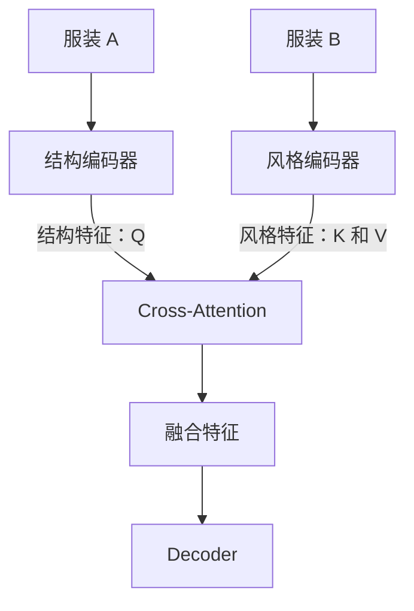

# 样本 05｜算法原理与数学推导

用户问题：Cross-Attention 是怎么计算的？

适用：数学、张量、算法与代码之间的对应讲解。以下为回答范例；服装特征融合是教学假设，不是对实际项目实现效果的断言。

---

# Cross-Attention 是怎么计算的？

Cross-Attention（交叉注意力）让一组特征根据自身与另一组特征的匹配程度，动态提取另一组的信息。不是简单拼接，而是先判断应该关注什么，再按关注程度提取信息。

## 1. What：它在网络中的位置

假设服装 A 提供结构（版型、空间布局），服装 B 提供风格（颜色、纹理）。编码器把图像变为特征，解码器把融合特征变回图像。



这里 Cross-Attention 负责跨特征交互。结构特征的不同位置可以从风格特征的不同位置提取信息。但它本身不保证结构与风格完全解耦。

## 2. Why：为什么不直接拼接？

假设两个特征均为 `[B, 512, 8, 8]`，B 是批大小，512 是通道数，8×8 是空间分辨率。

```python
fused = torch.cat([structure_code, style_code], dim=1)
# [B, 1024, 8, 8]
```

Concat 把两组特征放在一起，但这个操作本身并没有显式计算不同位置间的匹配关系。后续 CNN 可以学习融合；Cross-Attention 则直接提供基于相关性的动态选择机制。例如衣领位置和衣身位置可以获得不同的风格信息。实际对应关系由训练学习，不能假定某个注意力权重必然代表某个语义区域。

## 3. How：一次完整计算

### 3.1 Q、K、V 是什么？

| 变量 | 在本案例中的作用 |
|---|---|
| Q（Query，查询） | 结构位置用于寻找相关风格信息的特征 |
| K（Key，键） | 风格位置用于与 Q 匹配的特征 |
| V（Value，值） | 风格位置实际提供、最终被加权融合的特征 |

类似查书时用搜索内容匹配书名，再阅读真正需要的内容。类比只解释职责，实际 Q、K、V 是训练学习的数值特征。

### 3.2 从特征图到 Q、K、V

先把每个 8×8 特征图的空间维度展开，得到 64 个位置，每个位置对应 512 维向量：

```python
structure = structure_code.flatten(2).transpose(1, 2)
style = style_code.flatten(2).transpose(1, 2)
# 均为 [B, 64, 512]
```

分别使用三个可学习的线性变换：

$$Q=X_{structure}W_Q,\qquad K=X_{style}W_K,\qquad V=X_{style}W_V$$

若投影维度为 128，三个输出均为 `[B, 64, 128]`。不同的线性变换使网络能够学习匹配所用信息和实际需要提取的信息。

### 3.3 先手算一个小例子：匹配得分

为了看清机制，暂时缩小为两个结构位置、两个风格位置，每个向量只有两个分量。假设投影后的张量是：

$$Q=\begin{bmatrix}1&0\\0&1\end{bmatrix},\quad K=\begin{bmatrix}2&0\\0&2\end{bmatrix}$$

点积（Dot Product）就是对应分量相乘后相加。例如第一个 Q 与第一个 K 的得分为 $1\times2+0\times0=2$，与第二个 K 的得分为 $1\times0+0\times2=0$。

合并所有匹配结果：

$$S=QK^T=\begin{bmatrix}2&0\\0&2\end{bmatrix}$$

每一行表示一个 Query 与所有 Key 的匹配得分。点积受向量方向和大小影响，并不天然等同于语义相似度。

### 3.4 将得分转为权重

特征维度增加时，点积的数值波动通常也会增加。过大的得分差可能让 Softmax 过度集中，影响梯度。因此先除以 Key 的维度的平方根。本例 $d_k=2$：

$$S/\sqrt{d_k}=\begin{bmatrix}1.414&0\\0&1.414\end{bmatrix}$$

Softmax 将一组得分变成总和为 1 的非负权重。对第一行：

$$a_1=\frac{e^{1.414}}{e^{1.414}+e^0}\approx0.8044,\qquad a_2\approx0.1956$$

逐行应用 Softmax，得到注意力权重：

| Query / Key | K1 | K2 |
|---|---:|---:|
| Q1 | 0.8044 | 0.1956 |
| Q2 | 0.1956 | 0.8044 |

第一行说明 Q1 更关注 K1；第二行说明 Q2 更关注 K2。每一行的权重总和为 1。

### 3.5 使用权重实际融合 V

假设 Value 为：

$$V=\begin{bmatrix}10&0\\0&5\end{bmatrix}$$

第一个结构位置的输出：

$$o_1=0.8044[10,0]+0.1956[0,5]=[8.044,0.978]$$

第二个位置以同样的方式计算：

$$o_2=0.1956[10,0]+0.8044[0,5]=[1.956,4.022]$$

所以两个结构位置虽然访问同一组风格特征，却得到不同的输出。原因是不同 Query 产生了不同权重。

### 3.6 回到通用公式

$$\boxed{O=\operatorname{Softmax}\left(\frac{QK^T}{\sqrt{d_k}}\right)V}$$

```text
Q、K → 点积得分 → 缩放 → Softmax 权重
                                 │
V ───────────────────────────────┴→ 加权求和 → 输出
```

先决定应该关注什么，再决定实际提取多少信息。

## 4. 从公式到 PyTorch 实现

```python
import math
import torch


def cross_attention(q, k, v):
    scores = q @ k.transpose(-2, -1)       # QK^T
    scores = scores / math.sqrt(q.shape[-1])
    weights = torch.softmax(scores, dim=-1)
    return weights @ v, weights

q = torch.tensor([[1., 0.], [0., 1.]])
k = torch.tensor([[2., 0.], [0., 2.]])
v = torch.tensor([[10., 0.], [0., 5.]])
output, weights = cross_attention(q, k, v)
print(weights)
print(output)
```

预期输出约为（可运行验证，未在此执行）：

```text
weights: [[0.8044, 0.1956], [0.1956, 0.8044]]
output:  [[8.0443, 0.9779], [1.9557, 4.0221]]
```

这是已经取得 Q、K、V 后的核心计算。回到实际服装张量，在单头且投影维度为 128 的设定下：

| 步骤 | Shape |
|---|---|
| 输入结构、风格特征 | `[B, 512, 8, 8]` |
| 展平与转置 | `[B, 64, 512]` |
| Q、K、V 投影 | `[B, 64, 128]` |
| Q 乘 K 转置 | `[B, 64, 64]` |
| Softmax 权重 | `[B, 64, 64]` |
| 权重乘 V | `[B, 64, 128]` |
| 输出投影与恢复空间尺寸 | `[B, 512, 8, 8]` |

其中 `[B,64,64]` 不是新的图像特征，而是每个结构位置对 64 个风格位置的匹配权重。

实际项目中也可以使用封装模块：

```python
import torch.nn as nn

class CrossAttentionFusion(nn.Module):
    def __init__(self, channels=512, num_heads=8):
        super().__init__()
        self.attention = nn.MultiheadAttention(
            channels, num_heads, batch_first=True)
        self.norm = nn.LayerNorm(channels)

    def forward(self, structure_code, style_code):
        B, C, H, W = structure_code.shape
        structure = structure_code.flatten(2).transpose(1, 2)
        style = style_code.flatten(2).transpose(1, 2)
        output, _ = self.attention(query=structure, key=style,
                                   value=style, need_weights=False)
        output = self.norm(structure + output)
        return output.transpose(1, 2).reshape(B, C, H, W)
```

多头注意力将特征投影并分为多个头学习不同关系。残差连接把原始结构特征加回结果，提供保留路径；层归一化对每个位置的特征进行归一化，帮助稳定训练。本例 8 个头，每头维度为 512/8=64，与前面单头 128 维的设定不同，但每个头的核心运算相同。残差不保证生成结构完全不变。

## 5. When：适用场景与限制

在文生图中，Q 可来自图像、K/V 来自文本；虚拟试穿中，Q 可来自人体或结构特征、K/V 来自服装特征；多模态融合也可以利用跨特征交互。

标准注意力相关性计算复杂度约为 $O(NMd)$，其中 N、M 是查询和键的序列长度，d 是特征维度。若两组特征空间分辨率相同：

| 分辨率 | Token 数 | 单头得分数量 |
|---|---:|---:|
| 8×8 | 64 | 4,096 |
| 16×16 | 256 | 65,536 |
| 32×32 | 1,024 | 1,048,576 |
| 64×64 | 4,096 | 16,777,216 |

得分数量不是实际显存测量，优化实现可以避免显式保存完整矩阵。这解释了为什么全局注意力经常用于较低分辨率特征。

## 6. Compare：与其他方式的区别

Self-Attention 与 Cross-Attention 的核心公式相同，区别是 Q、K、V 来自哪里：

```python
# Self-Attention：同一组特征内部交互
attention(query=x, key=x, value=x)
# Cross-Attention：两组特征之间交互
attention(query=x, key=y, value=y)
```

| 方式 | 核心机制 |
|---|---|
| Add | 对应元素直接相加 |
| Concat | 合并特征，由后续网络学习融合 |
| AdaIN | 用风格特征的均值、标准差调整内容特征 |
| Self-Attention | 同一特征组内部的动态信息交互 |
| Cross-Attention | 不同特征组之间的动态信息提取 |

它们并非必须互相替代。例如可以先用 Self-Attention 增强结构，再用 Cross-Attention 融合风格，最后将结果交给 Decoder。

从数学看，Cross-Attention 是基于匹配得分的加权求和；从工程看，是一种可学习的动态信息融合机制。
